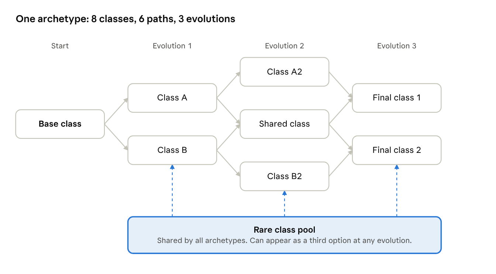

# Re: cursed — Game Design Document

Started 2026-11-15 by JP (Joseph Patrick Salomeo).

> This file is the master copy of the design since 2026-11-19. Change the design here, and log each decision in section 13. The old Claude Doc in claude.ai is retired.

## 1. Vision and pillars

Re: cursed is a turn-based, permadeath dungeon RPG. You pick an archetype, evolve it along branching paths, and descend a dungeon that remembers each run.

**Pillars (draft, confirm each one)**

1.  **The build is the game.** Archetype, evolution path, and skills decide how each run plays.

2.  **Death is final.** A dead character does not come back. A new run means a new character.

3.  **The dungeon remembers.** Floors repeat with changes. Old runs leave traces.

4.  **Small scope, high finish.** Less content, each piece polished.

**References**

- [Buriedbornes](https://store.steampowered.com/app/2153310/Buriedbornes__Dungeon_RPG/): job choice at the start, skill and equipment synergy, permadeath, dead heroes as enemies. The art does not copy its look.

- [First version of Re: cursed](https://github.com/ysxiaixsy/Re-cursed) (Java Swing): source of the dungeon premise.

## 2. Core loop

One run is one character, from archetype choice to death or the final boss. This loop is a proposal that follows from the decisions in section 13.

1.  Pick an archetype.

2.  Choose the next room.

3.  Resolve the room: fight, event, or loot.

4.  Take the reward: skill, equipment, or progress toward an evolution.

5.  Evolve when the condition is met.

6.  Beat the floor boss and go down one floor.

7.  The run ends on death or on the final boss. The dungeon records the run. Start again.

**Decided**

- A full run takes at least about 20 minutes with fast play.

**Open**

- The real run length at each speed. The vertical slice measures it.

## 3. Archetypes

The player picks one archetype at the start of a run. The archetype decides the skill pool and the evolution paths for that run.

**Decided**

- The player picks an archetype and an origin at the start. The archetype sets the class tree. The origin adds one passive and one starting skill or item.

- Launch target: 4 archetypes x 4 origins = 16 different starts. Vertical slice: 1 archetype and 2 origins.

- An origin needs no new sprite. Variety comes from the combination, not from more trees.

**The 4 archetypes**

| Archetype | Unique mechanic                                                | Two directions                     |
|-----------|----------------------------------------------------------------|------------------------------------|
| Warrior   | Rage: builds when hit or hitting, spent on strong skills       | Defence / raw damage               |
| Mage      | Charge: a spell held for more turns hits harder                | Burst / control                    |
| Rogue     | Tempo: skills that move its own marker forward on the turn bar | Critical hits / poison and debuffs |
| Acolyte   | Faith: heals and wards, which convert into damage              | Support / smite                    |

The vertical slice uses the Warrior.

**The 4 origins are curses**

Each origin is a curse the character carries: one power and one drawback.

- **Hunger:** kills heal the character; other healing is weaker.

- **Glass:** more damage; less maximum HP.

- **Greed:** more loot; enemies are stronger.

- **Echo:** the first skill in each fight casts twice; cooldowns are longer.

**Constraint**

Total classes = archetypes x classes per tree. A tree with 3 evolutions and 2 branches at each tier has 15 classes. Six such archetypes need 90 classes, each with a sprite and skills. The lattice in section 5 cuts one tree to 8 classes. Four archetypes and 4 rare classes need 36.

**Open**

- Class names for the Mage, Rogue, and Acolyte lattices.

- Numbers for each mechanic and each curse.

- The feat that unlocks each locked archetype and curse.

**Unlocks between runs**

- Available from the first run: Warrior and Mage, with the Hunger and Glass curses.

- Unlocked by feats: Rogue, Acolyte, Greed, and Echo. Example: reach floor 3 to unlock the Rogue.

- An unlock never adds power. It adds new ways to start.

- There is no currency.

## 4. Combat

Combat is turn-based, party against a group of enemies. The party is optional: a solo character must be able to finish a run.

**Decided: skills**

- A character has 4 skill slots.

- Slot 1 holds the signature skill of the archetype. It cannot be replaced. It upgrades at each evolution.

- Slots 2 to 4 are free. Class skills from evolutions and skills from loot and events fill them.

- When the free slots are full, the player replaces one skill or declines the new one. A declined skill becomes a small upgrade to a held skill.

- Passives do not use slots. They stack: the character keeps the passive of each class on its path, 3 by the end of a run.

**Decided: party**

- The player controls each character in the party. There is no option for the AI to play a party member. The AI plays enemies only.

- A solo hero keeps all resources for itself. It has a higher risk against enemies that counter it. A party can cover for the character that is countered.

**Decided: the party comes from the dead**

- When the player defeats a dead character, the player chooses: lay it to rest and take one item, or bind it into the party and take no item. In both cases it leaves the pool.

- The party is the hero plus at most 2 bound allies.

- Allies are frozen. They keep the class, skills, and passives they died with. They do not evolve.

- A bound ally that dies is gone for good. If the hero dies, the run ends.

- Experience is divided by party size. Healing and items are shared.

**Decided: turn bar**

Turn order uses a turn bar, as in Ninja Saga. It replaces fixed rounds.

1.  Each character and enemy has a Speed stat. Its marker moves along the bar at that speed. The first marker to reach the end takes a turn, then returns to the start.

2.  The bar stops while the player chooses an action. There is no time pressure.

3.  The fastest character is at most 2 times the slowest. This stops Speed from becoming the only stat that matters.

4.  Cooldowns count in the owner's own turns. Status effects count in the turns of the affected character.

5.  Some Rogue skills leave the Rogue's marker part of the way along the bar after use.

6.  Other skills can move markers too: an enemy can knock a marker back, and an Acolyte can push an ally forward.

**Decided: skill cost**

- All skills use cooldowns. There is no mana.

- The archetype mechanic is the only resource: Rage, Charge, Tempo, or Faith. Strong skills spend it.

**Decided: exact turn bar and damage rules**

- Each tick, the gauge of each living unit increases by its Speed. A unit with gauge 100 or more is ready.

- If more than one unit is ready, the unit that crossed 100 first acts first. If that is equal, player units act first, then enemies from left to right.

- After a unit acts, its gauge decreases by 100. The rest carries over.

- Damage uses integer math, rounded half up, at least 1. Combat has no randomness.

- tools/sim/reference_sim.py in the repo is the exact rule model. The web code must give the same results.

**Decided: fight length**

- A normal fight takes about 4 Warrior turns. An elite fight takes about 7. A boss fight takes about 12.

- The first numbers for the Warrior, 5 enemies, and the floor 1 boss are in the [combat sheet](https://claude.ai/artifact/MA4ncZrWYgp3rFbt5BRBgF). They are a first pass for tuning, not final values.

**Decided: free actions and the cooldown rule**

- Some skills are free actions. A free action does not end the turn. Guard and Warcry are free actions. Rage is their only limit.

- A skill with cooldown N cannot be used during the owner's next N turns.

**Result of the M2 playtest (simulation, 2026-11-17)**

- A program played all 7 floor 1 fights with the sheet's rules and searched each possible choice.

- With the first numbers, Slash alone was the best play in 6 of 7 fights. The skills were not worth a turn.

- After the changes (free actions, Slash gives 20 Rage, Cleave at 100%, Crush at 300%), best play is different in each fight. It beats Slash alone and it beats "use each skill when ready".

- Best play, with the exact integer rules (D34): normal fights take 2 to 4 turns and cost 12% to 22% HP. The elite takes 5 turns and costs 42%. The boss takes 11 turns and costs 57%.

- Limit: a simulation shows that choices matter. It does not show that a fight is fun. A person must play the slice to judge that.

**Open**

- Speed values for the Mage, Rogue, and Acolyte.

- The list of status effects.

**Risk**

Each party member needs sprites, skills, and balance work. Party support multiplies content cost. It is the first feature to cut or delay if scope becomes a problem.

## 5. Class evolution

A character becomes stronger by evolving its class along branching paths. Examples from JP: Mage to Sage; Warrior through several steps to Soulrender. The usual terms are class evolution, job advancement, or promotion tree.

**Decided**

- A path has 3 evolutions after the base class. The slice tests this number.

- Each archetype tree is a lattice of 8 classes: 1 base, 2 at evolution 1, 3 at evolution 2, 2 at evolution 3. The middle class at evolution 2 can be reached from both sides.

- At each evolution the player chooses between 2 classes.

- Rare classes are in one pool that all archetypes share. Launch target: 4 rare classes.

- Luck is the main factor for a rare class. Each evolution has a small chance to offer one as a third option. Each rare class also has a hidden condition. A player who meets it gets a higher chance for that class.

- Start values for tuning: 5% chance with no condition met, 25% with the condition met.

class lattice for one archetype · 8 classes, 1 shared rare pool

The shared class in the middle gives 6 paths from 8 classes. A full tree with 2 branches at each tier needs 15 classes for 8 paths. Class names are placeholders.

**How one evolution works**

1.  The trigger is a floor boss kill.

2.  The choice screen shows the 2 classes that the lattice allows from the current class. Sometimes a third, rare option appears.

3.  The player picks one. The choice is permanent for that run.

4.  The new class changes four things: the stat growth, 1 new class skill, 1 passive that changes the archetype mechanic, and the sprite.

**Example: the Warrior lattice**

| Stage       | Options                                                                               |
|-------------|---------------------------------------------------------------------------------------|
| Start       | Warrior                                                                               |
| Evolution 1 | Knight (defence) or Berserker (damage)                                                |
| Evolution 2 | Knight goes to Guardian or Warlord. Berserker goes to Warlord or Slayer.              |
| Evolution 3 | Guardian goes to Bastion. Warlord goes to Bastion or Ravager. Slayer goes to Ravager. |

Warlord is the shared class. Passives stack (section 4), so two paths to the same final class give two different builds.

**Rare class rules**

- The normal lattice is visible from the start. A rare class shows as "???" until the player finds it once. Found rare classes stay in a codex between runs. The codex gives no power.

- A rare class does not branch. At each later evolution it upgrades itself, for example Soulrender I, II, III, with the same sprite.

- A rare class taken early is strong, but it closes the lattice for that run.

- Example of a hidden condition: Soulrender gets its higher chance when the player lays one of their own dead characters to rest in that run.

**Constraint**

Death is permanent. A full evolution path must therefore fit inside one run.

**Open**

- Names and hidden conditions of the other 3 rare classes.

- Class names for the Mage, Rogue, and Acolyte lattices.

- Skills and passives for each class.

## 6. Dungeon and the loop

The dungeon repeats, and it remembers. This premise comes from the first version's README.

- Floors repeat with small changes.

- Enemies return in new forms.

- Loot and traces of other adventurers appear where they should not.

- A final boss waits at the deepest floor. Its defeat can free the player or restart the descent.

**Decided**

- The dungeon remembers in the Buriedbornes way: dead characters return as enemies in later runs.

- The game is offline. The pool of dead characters starts with about 3 randomized presets. Each character the player loses is added to the pool.

- Presets are generated from the same class, skill, and item data as player characters. They need no extra content.

- A dead character that the player defeats leaves the pool for good. The player lays it to rest and takes one item, or binds it into the party (section 4).

- The pool holds at most 8 of the player's own dead. When it is full, a new death replaces the one that died on the shallowest floor.

- A dead character appears near the floor where it died. At most 1 appears on each floor.

- Presets refill the pool when it has fewer than 3 characters.

**Decided: run structure**

A run has 4 floors. Floors 1 to 3 each end with a boss and an evolution. Floor 4 ends with the final boss.

**Decided: rooms**

- Each floor has 5 rooms and then the boss. A run has 20 rooms and 4 bosses.

- Before each room, the player chooses between 2 or 3 doors. Each door shows its room type.

- Room types: Fight, Elite, Event, Treasure, Rest, and Grave. The boss room is fixed at the end of the floor.

- A Grave holds a dead character. At most 1 Grave appears on a floor. The player can see it and can avoid it.

- No shop and no currency in the first version.

- Time estimate: about 20 minutes with fast play at high speed, about 40 minutes at normal speed. The vertical slice measures the real values.

**Open**

- How each floor differs from the one before: enemies, events, look.

- How "floors repeat with small changes" appears between runs.

## 7. Enemies and bosses

The first enemy list for floor 1 is in the combat sheet (section 4): Crypt Spider, Bone Guard, Grave Rat, Hollow Acolyte, Rage Leech, and the boss, The Warden. Milestone M2 tunes their numbers.

**Decided**

- Some enemies counter one archetype, for example an enemy that drains Rage. A solo hero has no cover against its counter.

**Open**

- Enemy count for the vertical slice. Proposal: 5 enemies and 1 boss.

- How "enemies return in new forms" works as a mechanic.

- Enemy behaviour: fixed patterns the player can learn, or random skill use.

## 8. Items and loot

A character has 3 equipment slots and the party shares 3 consumable slots.

**Decided**

- Equipment slots: Weapon, Armor, Relic.

- A Weapon and an Armor give stats. A Relic gives one effect that changes how a build plays.

- A Relic can be the hidden condition for a rare class.

- Consumables: a heal potion, a cleanse potion, and a haste potion that pushes a marker forward on the turn bar.

- A dead character keeps its equipment. When the player lays it to rest, the player gets one of those items.

**Open**

- The item list and the Relic effects for the vertical slice.

- Item rarity levels, if any.

## 9. Narrative and world

The only fixed line is the last line of the old README: "The dungeon remembers."

**Decided**

- The player character is cursed. Each origin is a curse that the character carries into the dungeon.

**Open**

- Where the curses come from.

- Meaning of "Re:" in the title.

- How the story is told: item text, events, boss lines, or none.

## 10. Art and audio direction

The art is dark and grim, close in mood to Buriedbornes and Fear & Hunger (JP's references, 2026-11-18). A second art test sets the exact style. Claude Code makes it with Aseprite scripts. JP passed the art test (M1) on 2026-11-17.

**Decided: dark tone (replaces the clean tone of D30)**

- Dark locations, closest to Fear & Hunger: each room has real background art, but most of it is in shadow. A pool of light shows the fight area. Very dark rooms can be almost fully black.

- Muted, earthy colours with a few strong accents: blood red, sickly purple, bone.

- Ink-illustration look: dark linework, flat colour fills with 2 to 3 tones, one cold rim light.

- No body horror, no gore, no nudity. The threat comes from darkness and mood. The gameplay stays close to Buriedbornes.

- Large sprites: an enemy fills about half the screen width, as in the references.

- Heroes face the player. Each hero class has one sprite.

- M3 has static sprites with simple hit effects: flash, shake, damage numbers. Ability animations come after M3.

**Still valid from the first art test**

- Palette: Endesga 32, unchanged, for all assets.

- Character sprites are 64 x 64. The floor 1 monster is 80 x 80.

- Light comes from the top left. Sprites and icons have a dark outline, 1 pixel wide.

- A Lua script in tools/art/ draws each asset. A rebuild gives the same files.

- The palette, sprite sizes, and tone in this list are replaced by the dark tone above. The second art test (A0, at 360 x 640) sets the new values.

**Known weak points, to fix during the slice**

- The font is 5 pixels tall. It was not checked on a phone.

- The dither on the walls and floor looks grainy at 4 times scale.

- The Warrior is small on the battle screen.

**Decided: resolution**

The base resolution is 270 x 480 pixels, portrait, 9:16. It scales by whole numbers only: 4 times gives 1080 x 1920 on a phone, and 2 times gives 540 x 960 in a desktop window. A taller phone screen shows more background above and below the play area. The art test uses this size.

**Open**

- Boss sprite size. The A1 issue draft uses 128 x 128.

- Final battle screen layout. The art test mockup is the starting point.

- Animation: static sprites with hit effects cost least. Full animation costs most.

- Audio: music and sound sources. Not discussed yet.

## 11. UI and UX

Seven screens cover one full run. The first version had three: intro, character selection, and the game loop.

1.  Title

2.  Archetype select

3.  Dungeon view with room choice

4.  Battle

5.  Evolution choice

6.  Character sheet: skills, equipment, evolution path

7.  Run summary on death or victory

**Decided**

- Platforms: mobile and desktop. Mobile is the main platform.

- The game is in portrait on both platforms. The desktop version shows the same portrait layout in a window, with background art around it. There is one layout to build and test.

- A speed control changes the speed of animations and of the turn bar: 1x, 2x, 3x. A 5x step is added if fights stay readable at that speed.

- Input is touch on mobile and mouse on desktop.

**Open**

- Keyboard shortcuts on desktop.

- A wider desktop HUD with side panels, for example the class lattice and a fight log. This is an option for after the vertical slice.

- Layout of each of the 7 screens in portrait.

## 12. Scope and milestones

Build one small, complete slice of the game before any content is added. The first version failed on time and resources, so each milestone has a clear exit condition. This order is a proposal.

| Milestone          | Content                                                                         | Exit condition                                   |
|--------------------|---------------------------------------------------------------------------------|--------------------------------------------------|
| M0 GDD v1          | All sections of this document decided for the slice                             | No open question blocks the slice                |
| M1 Art test        | 1 hero, 1 enemy, 1 background, 1 UI frame                                       | JP accepts the look, or the style changes        |
| M2 Combat on paper | Stats, skills, and enemy numbers in a sheet                                     | A fight can be played by hand and is not trivial |
| M3 Vertical slice  | 1 archetype, 1 evolution with 2 branches, 1 floor, 5 enemies, 1 boss, solo only | A full floor is playable from start to boss      |
| M4 Expansion       | Party, more archetypes, more floors                                             | Decided after M3                                 |

Status on 2026-11-17: M0, M1, and M2 are complete. M3, the vertical slice, is next. Its plan is below.

**M3 plan: web vertical slice**

The slice has 4 stages and 1 art track. Each stage ends with something JP plays on his phone. All build instructions for Claude Code are in one file in the repo, HANDOFF.md.

| Stage                    | Content                                                                                       | Exit condition                                       |
|--------------------------|-----------------------------------------------------------------------------------------------|------------------------------------------------------|
| S1 First fight           | Web project, combat core, battle screen, debug fight picker, live URL                         | Parity tests pass. JP plays two fights on his phone. |
| S2 One full floor        | Start screen, curses, doors, Fight, Elite, Rest, Treasure, the Warden, saves, installable app | JP plays 3 runs on his phone.                        |
| S3 Evolution and floor 2 | Knight or Berserker, skill slots, floor 2                                                     | Knight and Berserker play differently.               |
| S4 The dungeon remembers | Dead pool, Grave room, Lay to rest                                                            | JP meets his own dead Warrior.                       |
| A1 Art for the slice     | 5 monsters, Knight, Berserker, portraits, font, door icons                                    | Art checks pass. JP accepts the look.                |

**Proposal, not yet accepted: slice scope**

- The slice has floor 2: floor 1 again, with stronger enemies and a stronger Warden. Without it, the player chooses an evolution and never plays it.

- The slice has no levels and no experience. The hero grows through items, skill upgrades, and the evolution. The M2 numbers assume a hero without levels.

- Event rooms come after the slice. They need written content and do not test combat.

**Cut order if time runs out**

1.  Party system

2.  Extra archetypes

3.  Animation

No dates are set. The tech stack is web: D33, and ADR 0001 in the repo.

## 13. Decision log and open questions

Forty-two decisions are made. Everything not in this table is a proposal or an open question.

| \#  | Decision                                                                                                                                                                    | Decided    |
|-----|-----------------------------------------------------------------------------------------------------------------------------------------------------------------------------|------------|
| D1  | The GDD comes first. Tech stack is decided later.                                                                                                                           | 2026-11-15 |
| D2  | Progression is class evolution along branching paths.                                                                                                                       | 2026-11-15 |
| D3  | Death is permanent. Each run starts a new character.                                                                                                                        | 2026-11-15 |
| D4  | Combat is party against group. The party is optional.                                                                                                                       | 2026-11-15 |
| D5  | Art is made by Claude Code with Aseprite.                                                                                                                                   | 2026-11-15 |
| D6  | A path has 3 evolutions. Some evolutions are rare and hard to predict.                                                                                                      | 2026-11-16 |
| D7  | Dead characters return as enemies in later runs, as in Buriedbornes.                                                                                                        | 2026-11-16 |
| D8  | More than 2 starting archetypes.                                                                                                                                            | 2026-11-16 |
| D9  | A start is archetype plus origin. Launch target 4 x 4. Each tree is an 8-class lattice.                                                                                     | 2026-11-16 |
| D10 | Rare classes are a shared pool. Luck first; a hidden condition raises the chance.                                                                                           | 2026-11-16 |
| D11 | Offline. The dead pool starts with about 3 random presets, then adds the player's own dead.                                                                                 | 2026-11-16 |
| D12 | Dead pool rules: a defeat removes for good, cap of 8, 1 per floor near the death floor, presets refill below 3.                                                             | 2026-11-16 |
| D13 | Archetypes: Warrior, Mage, Rogue, Acolyte. The slice uses the Warrior.                                                                                                      | 2026-11-16 |
| D14 | Origins are curses: Hunger, Glass, Greed, Echo.                                                                                                                             | 2026-11-16 |
| D15 | A floor boss kill triggers an evolution. A run has 4 floors. An evolution changes stat growth, 1 skill, 1 passive, and the sprite.                                          | 2026-11-16 |
| D16 | The lattice is visible. Rare classes are hidden until found, do not branch, and upgrade themselves.                                                                         | 2026-11-16 |
| D17 | 4 skill slots: 1 locked signature skill and 3 free. Passives stack and use no slots.                                                                                        | 2026-11-16 |
| D18 | The player controls each party member. The AI plays enemies only.                                                                                                           | 2026-11-16 |
| D19 | Solo keeps all resources but has no cover against counter enemies. A party covers for the countered character.                                                              | 2026-11-16 |
| D20 | Turn order uses a turn bar driven by Speed, as in Ninja Saga. Fastest is at most 2 times the slowest.                                                                       | 2026-11-16 |
| D21 | Skills use cooldowns only. The archetype mechanic is the one resource.                                                                                                      | 2026-11-16 |
| D22 | The party comes from the dead: bind instead of taking the item, 2 allies at most, frozen allies, experience divided by party size.                                          | 2026-11-16 |
| D23 | Mobile and desktop, mobile first. Portrait on both. Desktop shows the same layout in a window.                                                                              | 2026-11-16 |
| D24 | A speed control: 1x, 2x, 3x, and 5x if fights stay readable.                                                                                                                | 2026-11-16 |
| D25 | A full run takes at least about 20 minutes with fast play.                                                                                                                  | 2026-11-16 |
| D26 | Each floor has 5 rooms and a boss. The player picks from 2 or 3 doors. Room types: Fight, Elite, Event, Treasure, Rest, Grave. No shop or currency in the first version.    | 2026-11-16 |
| D27 | Base resolution is 270 x 480, portrait, scaled by whole numbers. Replaced by D38.                                                                                           | 2026-11-16 |
| D28 | Items: Weapon, Armor, Relic, and 3 shared consumable slots. A Relic can be a rare class condition.                                                                          | 2026-11-16 |
| D29 | Unlocks by feats, no currency. Warrior, Mage, Hunger, and Glass are available from the first run.                                                                           | 2026-11-16 |
| D30 | The art test passed. The clean tone stays. Endesga 32, 64 x 64 characters, top-left light, 1-pixel outline. The tone part is replaced by D36.                               | 2026-11-17 |
| D31 | Fight length: about 4 Warrior turns for a normal fight, 7 for an elite, 12 for a boss.                                                                                      | 2026-11-17 |
| D32 | Free actions exist: Guard and Warcry do not end the turn. M2 passed by simulation with the tuned numbers.                                                                   | 2026-11-17 |
| D33 | First iteration is web: TypeScript, Vite, Phaser 4, on GitHub Pages. One repo, one folder per iteration. core/ has no engine code. ADR 0001.                                | 2026-11-17 |
| D34 | Turn bar and damage use integer math. Ties: earliest crossing, then player units, then left to right. reference_sim.py is the exact rule model.                             | 2026-11-17 |
| D35 | All build instructions for Claude Code are in one file, HANDOFF.md, in the repo. The GDD holds the design.                                                                  | 2026-11-17 |
| D36 | Dark, grim tone, closest to Fear & Hunger. Dark rooms with a pool of light, large sprites, ink-illustration look. A second art test sets the style. Heroes face the player. | 2026-11-18 |
| D37 | M3 has static sprites with simple hit effects. Ability animations come after M3.                                                                                            | 2026-11-18 |
| D38 | Base resolution is 360 x 640, scaled by 3 on a 1080 x 1920 screen. S2 makes the change.                                                                                                | 2026-11-18 |
| D39 | S2 design accepted: rewards, 6 items, 3 consumables, one upgrade for each skill, curse numbers, door rules. No levels or experience in M3. Details in HANDOFF.md section 14 and data/. | 2026-11-18 |
| D40 | Each skill takes two taps: select, then fire. Floor-wide HP loss, not single fights, is what kills a weak player.                                                                      | 2026-11-18 |
| D41 | No body horror, no gore, no nudity. The threat comes from darkness and mood. S1 passed JP's laptop test.                                                                               | 2026-11-18 |
| D42 | docs/GDD.md in the repo is the master copy of the design. Design work happens in Claude Code with JP. docs/CHANNEL.md is no longer needed. | 2026-11-19 |

**Next questions, in order**

- [ ] Before S3: Knight and Berserker (stats, class skill, passive), the floor 2 multiplier, and the stronger Warden.
- [ ] Before S4: AI rules for a dead hero, and the 3 preset dead heroes.
- [ ] Confirm the rest of the slice scope in section 12: floor 2, and Event rooms after M3.
- [ ] After the slice: the other 3 lattices, the other 3 rare classes, the unlock feats, and the story.
